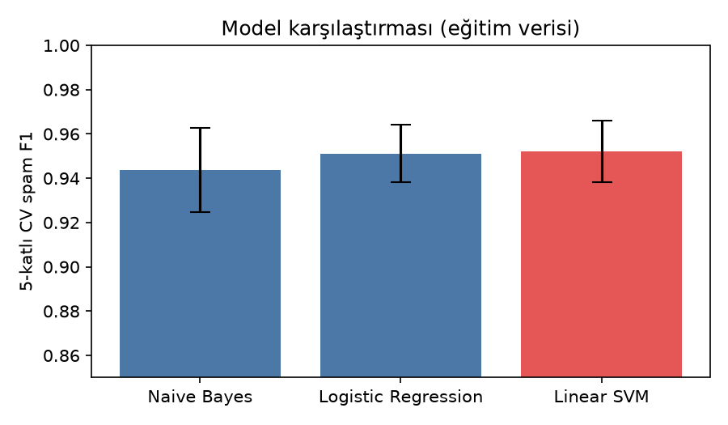
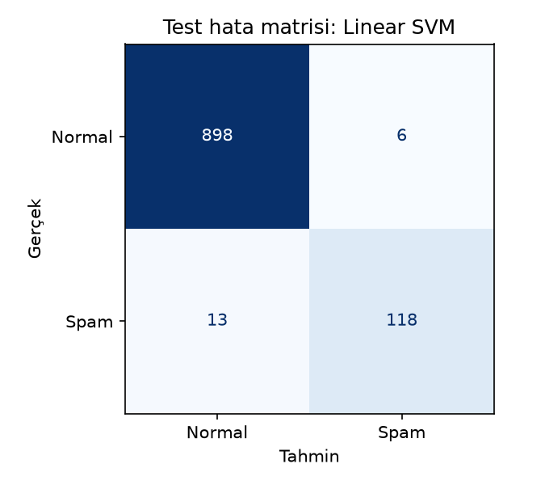
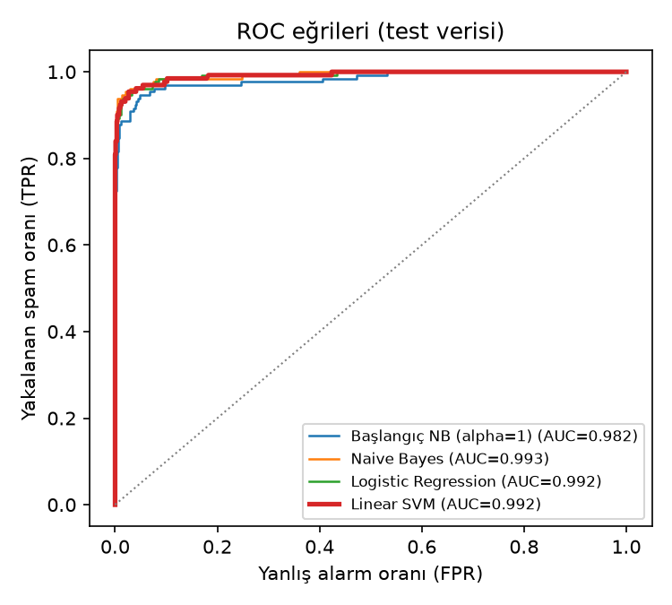
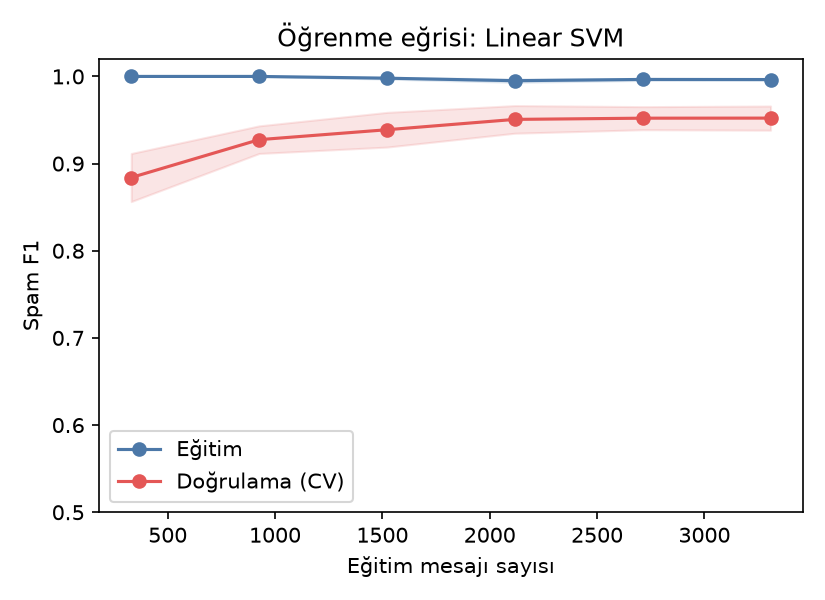

# SMS Spam Detection

İngilizce SMS mesajlarını **spam** veya **normal (ham)** olarak sınıflandıran bir denetimli (supervised) makine öğrenmesi projesi.

**Sonuç:** Seçilen model (TF-IDF + Linear SVM), eğitimde hiç görmediği 1.035 test mesajında spam mesajların **%90,1'ini** yakaladı. Spam dediği mesajların **%95,2'si** gerçekten spamdi (spam F1 = **0,925**).

---

## 1. Problem

- **Görev:** İkili metin sınıflandırma. Girdi bir SMS metni, çıktı `spam` veya `ham`.
- **Zorluk:** Veri dengesiz; mesajların yalnızca %12,6'sı spam. Her mesaja "normal" diyen bir model bile %87 doğruluk alır. Bu yüzden başarı ölçütü olarak doğruluk (accuracy) değil, **spam sınıfının F1 puanı** kullanıldı. F1, kaçırılan spam (recall) ile yanlış alarm (precision) arasındaki dengeyi ölçer.

## 2. Veri seti

[UCI SMS Spam Collection](https://archive.ics.uci.edu/dataset/228/sms+spam+collection). Kaynak: Almeida, T. & Hidalgo, J. (2011), DOI: [10.24432/C5CC84](https://doi.org/10.24432/C5CC84). Lisans: [CC BY 4.0](https://creativecommons.org/licenses/by/4.0/).

| | Kayıt |
|---|---:|
| Ham veri | 5.574 |
| Birebir tekrar (silindi) | 403 |
| **Temiz veri** | **5.171** (4.518 normal, 653 spam) |
| Eğitim (%80, sınıf oranı korunarak) | 4.136 |
| Test (%20) | 1.035 |

Tekrarlar eğitim/test ayrımından **önce** silindi. Silinmeseydi aynı mesaj hem eğitimde hem testte bulunabilir ve test sonucu olduğundan iyi görünürdü.

## 3. Yöntem

```
Ham metin ──► TF-IDF (kelime ağırlıkları) ──► Sınıflandırıcı ──► spam / ham
              └──────────── tek bir sklearn Pipeline ─────────────┘
```

1. **Özellikler:** TF-IDF. Bir kelime bir mesajda sık, tüm mesajlarda ise nadir geçiyorsa daha yüksek ağırlık alır. Tek kelimeler ve kelime ikilileri (bigram) denendi.
2. **Aday modeller:** Multinomial Naive Bayes, Logistic Regression ve Linear SVM.
3. **Ayar seçimi:** Her model için `GridSearchCV` ile **yalnızca eğitim verisinde** 5 katlı tabakalı çapraz doğrulama yapıldı. TF-IDF pipeline'ın içinde olduğu için her katta sadece o katın eğitim parçasında öğrenilir. Böylece doğrulama parçasından bilgi sızmaz.
4. **Model seçimi:** Ortalama CV spam F1 puanı en yüksek olan model seçildi.
5. **Test:** Test verisi seçim bittikten sonra **yalnızca bir kez** kullanıldı.

## 4. Sonuçlar

### Model karşılaştırması (5 katlı CV, eğitim verisi)

| Model | En iyi ayarlar | CV spam F1 |
|---|---|---:|
| Naive Bayes | alpha=0.01, kelime + bigram | 0,944 ± 0,019 |
| Logistic Regression | C=100, class_weight=balanced | 0,951 ± 0,013 |
| **Linear SVM** ✅ | C=1, class_weight=balanced | **0,952 ± 0,014** |



### Test sonuçları (1.035 mesaj)

| Ölçüt | Başlangıç modeli (NB, alpha=1.0) | Seçilen model (Linear SVM) |
|---|---:|---:|
| Doğruluk | %95,27 | %98,16 |
| Spam precision | %100,00 | %95,16 |
| Spam recall | %62,60 | **%90,08** |
| **Spam F1** | 0,770 | **0,925** |
| Yakalanan / kaçırılan spam | 82 / 49 | **118 / 13** |
| Normal mesajda yanlış alarm | 0 | 6 |



### ROC eğrisi ve öğrenme eğrisi

| | |
|---|---|
|  |  |

- **ROC AUC (test):** Linear SVM 0,992 · Logistic Regression 0,992 · Naive Bayes 0,993 · başlangıç NB 0,982. Başlangıç modelinin AUC'si bile yüksek: mesajları doğru sıralıyordu, sorun karar eşiğindeydi.
- **Öğrenme eğrisi:** Doğrulama F1 eğitim verisi arttıkça 0,88'den 0,95'e çıkıyor ve son adımlarda düzleşiyor. Daha fazla veri çok az kazandırır. Eğitim F1'in ~1,0 olması, modelin eğitim verisini neredeyse tamamen ayırabildiğini gösteriyor.

Tüm sayılar `reports/metrics.json` dosyasında.

### Yorum

- **Başlangıç modeli** hiç yanlış alarm vermiyor ama spamlerin üçte birinden fazlasını kaçırıyor. Bunun sebebi varsayılan `alpha=1.0` değerinin nadir spam kelimelerinin etkisini fazla bastırması.
- **Seçilen model** kaçırılan spam sayısını 49'dan 13'e indirdi. Bunun bedeli, 904 normal mesajdan 6'sında yanlış alarm.
- Üç modelin CV puanları birbirine çok yakın ve farklar standart sapmanın içinde kalıyor. Yani "Linear SVM açıkça en iyisi" denemez; üçü de bu veri için uygun. Seçim, önceden belirlenmiş kurala (en yüksek ortalama CV F1) göre yapıldı.

## 5. Geliştirme sürecinde düzeltilenler

Proje ilk olarak tek bir `main.py` betiğiydi. Teslim için şunlar değiştirildi:

| Önceki durum | Sorun | Düzeltme |
|---|---|---|
| Yalnızca Naive Bayes | Başka model ailesiyle karşılaştırma yoktu | Logistic Regression ve Linear SVM eklendi |
| Alpha denemesi 0.1–1.0, en iyisi 0.1 | En iyi değer aralığın ucundaydı, daha küçük değerler hiç denenmemişti | Aralık 0.001–1.0'a genişletildi. Yeni en iyi değer (0.01) aralığın içinde |
| Model diske kaydedilmiyordu | Her tahmin için yeniden eğitim gerekiyordu | `models/spam_model.joblib` olarak kaydediliyor |
| Eğitim ve etkileşimli tahmin aynı dosyadaydı | Tahmin yapmak için eğitimi beklemek gerekiyordu | `egit.py` ve `tahmin.py` ayrıldı |
| Sonuçlar yalnızca terminale yazılıyordu | Raporlanabilir ve tekrar üretilebilir değildi | `metrics.json` ve grafikler otomatik üretiliyor |

## Teslim dosyaları (Assignment 1)

| Dosya | İçerik |
|---|---|
| [docs/1_SMS_Spam_Linear_SVM.pptx](docs/1_SMS_Spam_Linear_SVM.pptx) | Sunum: Linear SVM'in fikri, matematiği, eğitimi ve projenin geliştirme süreci |
| [docs/Proje_Raporu.pdf](docs/Proje_Raporu.pdf) | Süreci anlatan proje raporu (SMS Spam + Futbol projeleri) |

## 6. Kurulum ve çalıştırma

Python 3.11 veya üzeri gerekir.

```bash
python -m venv .venv
.\.venv\Scripts\Activate.ps1        # Windows PowerShell
# source .venv/bin/activate         # macOS / Linux
python -m pip install -r requirements.txt
```

UCI sayfasından ZIP'i indirin ve içindeki `SMSSpamCollection` dosyasını adını değiştirmeden `data/` klasörüne koyun.

```bash
python src/egit.py                                      # eğit, değerlendir, kaydet (~1 dk)
python src/tahmin.py "WINNER! Claim your free prize"    # tek mesaj sınıflandır
python src/tahmin.py                                    # etkileşimli mod (çıkmak için q)
```

Tüm rastgelelikler `random_state=42` ile sabitlendi; aynı ortamda aynı sonuçlar üretilir.

## 7. Proje yapısı

```
sms-spam-model/
├── data/                  # SMSSpamCollection (depoda yok, indirilmeli)
├── src/
│   ├── veri.py            # okuma, temizleme, eğitim/test ayrımı
│   ├── egit.py            # model karşılaştırma, test, kaydetme, grafikler
│   └── tahmin.py          # kaydedilmiş modelle tahmin
├── models/spam_model.joblib
├── reports/
│   ├── metrics.json
│   └── figures/           # model karşılaştırma, hata matrisi, ROC, öğrenme eğrisi
└── requirements.txt
```

## 8. Sınırlar

- Sonuçlar bu veri setine ve bu bölünmeye aittir. Veri 2011 öncesine ait İngilizce mesajlardan oluşuyor; güncel spam türlerinde ve Türkçe mesajlarda başarı ölçülmedi.
- Yalnızca birebir tekrarlar silindi. Çok benzer mesajlar (ör. sadece numarası farklı spam kampanyaları) hem eğitimde hem testte bulunabilir, bu da test sonucunu biraz iyimser gösterebilir.
- Test seti 131 spam içeriyor. Tek bir mesajın sınıfı değişse recall yaklaşık 0,8 puan oynar, bu yüzden küçük farklar anlamlı değildir.
- Gerçek kullanımdan önce yeni ve bağımsız verilerle değerlendirme gerekir.
